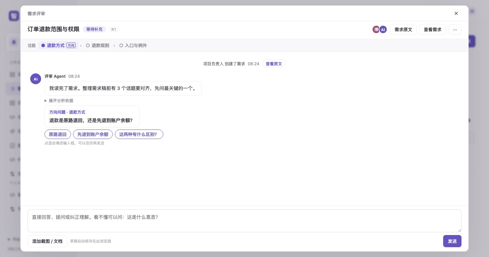
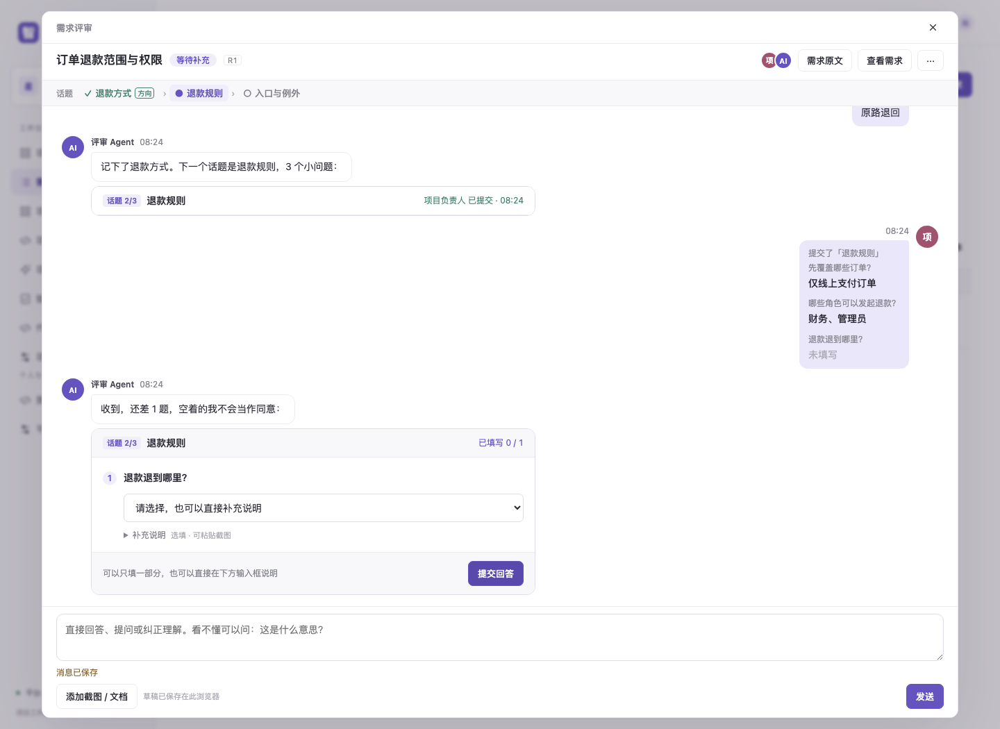
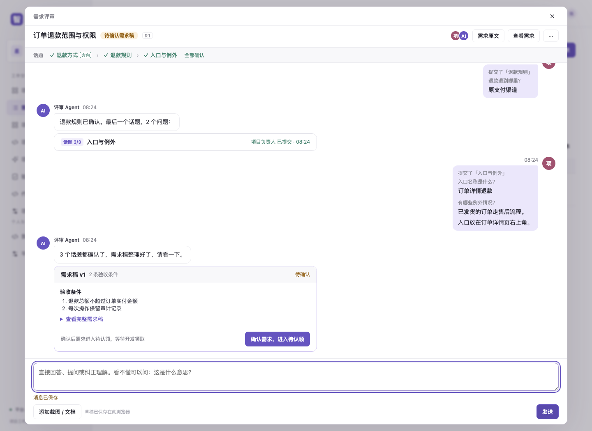
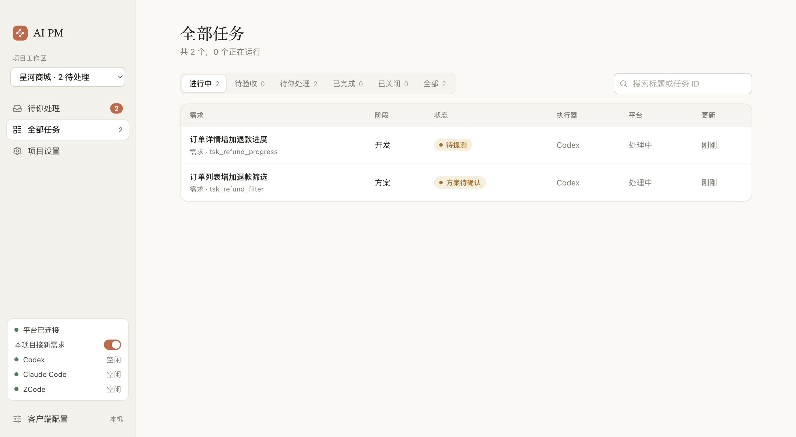
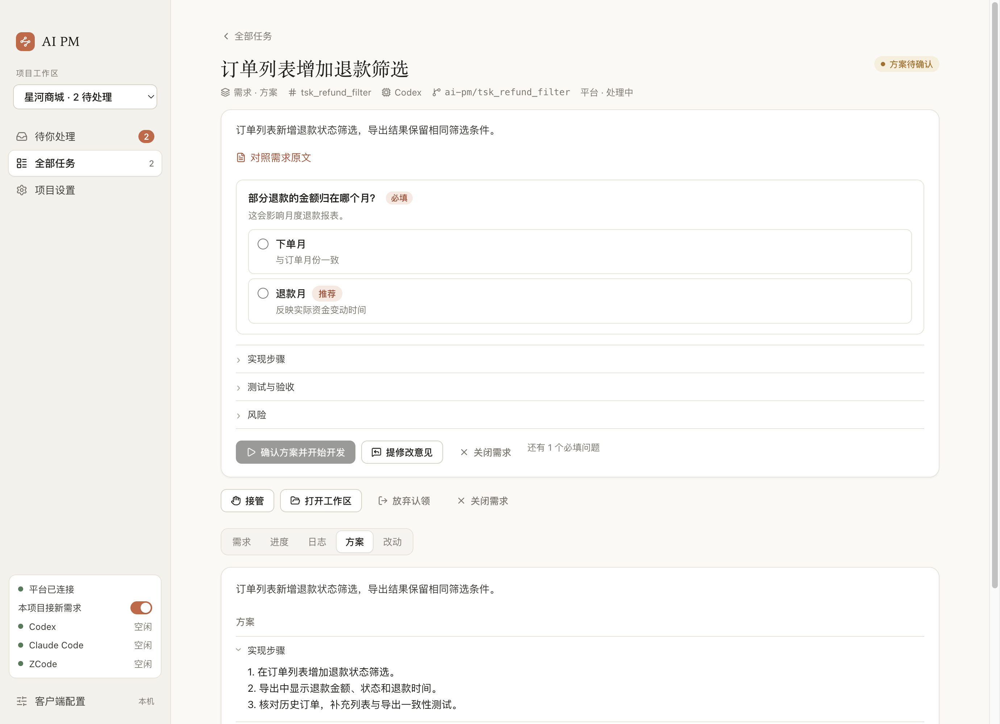
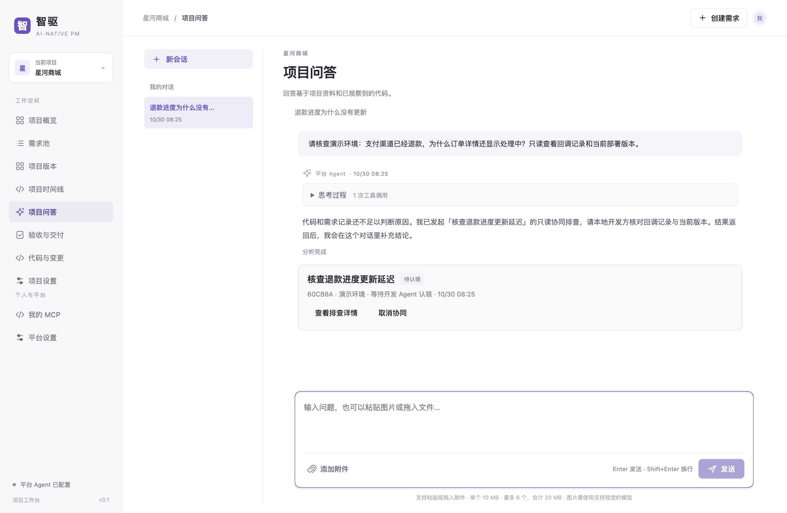
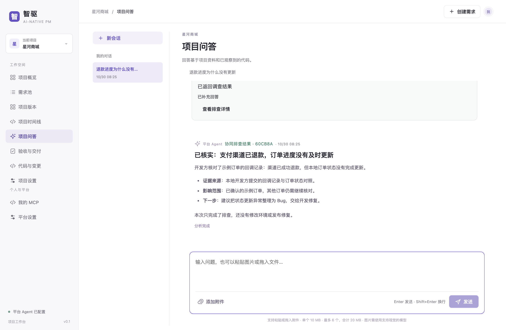
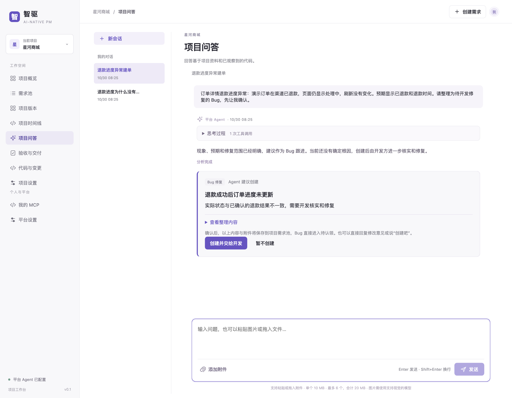
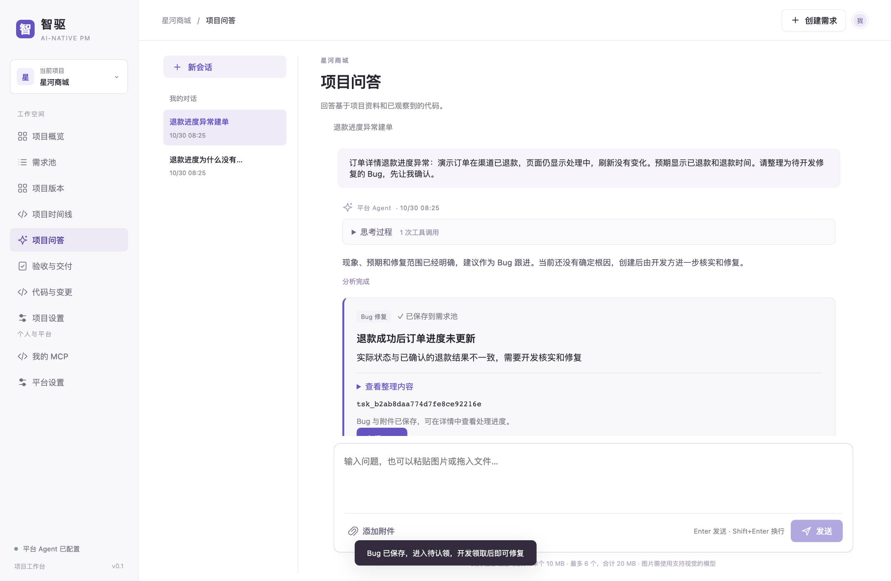
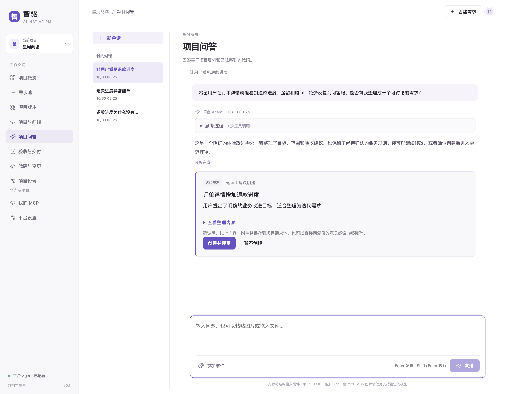

# 智驱 · AI 原生需求管理系统

**把产品想法聊清楚，让 Agent 接得住，让交付有据可验。**

**配套桌面客户端：[AI PM Desktop · ai-pm-desktop](https://github.com/xwatsonmai/ai-pm-desktop)**

智驱把需求讨论、Agent 评审、本地开发、问题排查和人工验收连在一起。产品可以从一句话、一张截图或一次问答开始，和 Agent 逐步明确目标、范围与验收条件；确认后的工作交给桌面客户端认领，在本机调用开发 Agent 推进。

你负责业务判断和最终确认，Agent 负责整理、追问、调查和执行。需求原文、讨论记录、开发结果与验收结论留在同一条工作流里。

## 项目组成

本仓库是智驱的平台主仓，配套的桌面客户端维护在独立仓库中。两者属于同一产品，独立开发和发版。

| 仓库 | 用来做什么 |
| --- | --- |
| [ai-pm-system](https://github.com/xwatsonmai/ai-pm-system)（平台主仓，本仓库） | 运行平台，供产品讨论需求、查看进度、测试和验收 |
| [ai-pm-desktop](https://github.com/xwatsonmai/ai-pm-desktop)（配套桌面客户端） | 在开发机器上接单，管理工作区并调度开发 Agent |

[多轮需求评审](#review) · [客户端接单](#desktop) · [问答协查](#investigation) · [Bug 建单](#bugs) · [对话转需求](#ideas) · [开始使用](#getting-started) · [路线图](#roadmap)

<a id="review"></a>

## 把需求聊清楚，再交给开发

“支持订单退款”还不是一份可以直接开发的需求。退款退到哪里、哪些订单适用、谁能操作、怎样算完成，都可能影响最终行为。

智驱的评审 Agent 会结合需求、附件和相关项目资料，把需要确认的内容拆成话题，和产品多轮讨论。

### 先确认方向，一次问清一个问题

Agent 先问会影响整个需求的关键选择。例如：“退款原路退回，还是先退到账户余额？”产品可以直接回答、追问选项有什么区别，或纠正 Agent 的理解。



### 产品回答后，再追问细节

方向确定后，Agent 再围绕一个话题提出少量具体问题。选择题可以附带推荐理由，也可以补充文字、截图和文档；不必把不适用的问题强行填完。

下面的例子里，产品确认了订单范围和操作角色，但没有填写退款去向。Agent 保留已答内容，只继续追问剩下的一题，未填写不会被当作同意。



### 形成需求稿，由产品确认

讨论清楚后，Agent 整理需求稿与逐条验收条件。产品可以继续修改，也可以确认后送入待认领；需求后续发生变化时，相关评审会重新核对。



评审中谁提出了什么、谁补充了说明、何时确认了哪一版，都有记录。多人参与时，大家围绕同一份需求讨论。

<a id="desktop"></a>

## 客户端接走工作，在本机推进开发

[AI PM Desktop](https://github.com/xwatsonmai/ai-pm-desktop) 是智驱的桌面客户端。连接平台并授权项目后，开启接单，客户端会读取工作列表、接收变化通知，并按项目设置和可用名额认领工作。

认领后，客户端准备独立的本地工作区，把需求、验收条件和相关附件交给开发 Agent。当前可以选择 **Codex、Claude Code、ZCode**，也可以同时服务多个项目。



**先看方案，再开始开发。** Agent 提交实现方案，需要业务判断的地方会单独提问。你可以回答、确认、要求再改一下；开发完成后，可以先做 AI 代码评审，再提测。



开发遇到新的业务疑问时，可以回到平台向产品请求对齐。测试通过后，按配置的发布说明执行上线；实际发布完成后登记环境与验证结果，再由人逐项验收。

典型流程：**确认需求 → 客户端认领 → 确认方案 → 开发与评审 → 测试 → 上线 → 人工验收**。

<a id="investigation"></a>

## 问答不止回答，还能请开发方协查

项目问答可以帮助你了解已有规则、需求进展和代码变化。遇到“为什么线上表现和预期不同”这类问题，Agent 可以把已知信息和待核实内容整理出来，请本地开发方补充环境证据。

### 发起有明确目标的协查

例如，产品反馈“渠道已经退款，订单却还显示处理中”。问答 Agent 创建只读协同排查，说明要核对的环境、现象和调查目标，对话里可以看到待认领、排查中和结果返回等状态。



### 结果回来后，在原对话继续解释

桌面客户端或其他已接入的开发方认领协查、读取证据并回传结果后，问答 Agent 会在原会话主动补充结论，说明依据、影响范围、仍未确认的内容和下一步。



协查完成表示调查结果已返回。需要修复时，再将问题整理成 Bug 并交给开发；发布和验收仍有各自的确认环节。

<a id="bugs"></a>

## 把问题整理成开发能接手的 Bug

发现异常时，可以在项目问答中描述现象、附上截图或文档。Agent 会结合当前项目查找相关事项，帮助补齐发生位置、触发条件、实际表现、预期行为和修复范围。

信息足够后，Agent 给出 Bug 建议。你可以修改内容、暂不创建，或点击“创建并交给开发”；也可以在对话中明确要求创建。未经证实的根因会保留为待核实内容。



确认后，Bug 保存到需求池并直接进入待认领，客户端可以接手修复。对话里保留真实的事项入口，方便继续查看进度。



测试中发现的问题也可以关联到原需求，修复、验证和复测围绕同一项交付继续推进。

<a id="ideas"></a>

## 从一句产品想法，长出一份正式需求

产品不需要先写好一整份需求文档。你可以先说：“希望用户能在订单详情看到退款进度，减少反复询问客服。”

问答 Agent 会识别其中值得跟进的业务目标，整理目标、范围、验收建议和待确认问题，展示创建建议。你可以继续讨论或纠正；明确同意后，整理内容和选中的相关附件才会共享到项目需求池。



选择“创建并评审”后，需求先保存，再在后台进入独立评审。有结论时会标记待确认，你也可以随时进入评审补充说明，继续上面的多轮讨论。

## 让该处理的人及时接住下一步

需求待补充、开发请求对齐、待测试、待上线、待验收等事项，会出现在站内“我的待办”。当前也支持企业微信推送：可以在卡片中完成的确认直接处理，需要补充文字或图片时打开对应页面。

一个人可以同时担任产品、开发和测试等角色，适合小团队协作。每次处理都会保留操作者与结果。

消息渠道配置见[待办与消息推送](docs/notifications.md)。

> 本文截图来自本地演示环境：使用真实平台和客户端界面、示例业务数据及确定性的演示 Agent 回复，不包含生产业务数据。实际分析与执行效果取决于项目上下文、模型和配置。截图说明见[图像目录](docs/screenshots/README.md)。

<a id="启动"></a>
<a id="getting-started"></a>

## 开始使用

本机体验平台需要 Go 1.26.2+、Node.js 22.19+、npm 和 Git：

```sh
npm ci --prefix runtime --ignore-scripts
go run ./cmd/server
```

打开 <http://127.0.0.1:8090>，创建项目并连接仓库。在“平台设置”配置模型后，即可体验评审和项目问答；开发方按[客户端说明](https://github.com/xwatsonmai/ai-pm-desktop#readme)连接平台并授权项目。

团队部署请先配置登录，详见[自部署指南](docs/self-hosting.md)与[登录方式](docs/login.md)。当前使用 SQLite 保存数据，MySQL 与 PostgreSQL 的支持列在下方路线图中。

## 进一步了解

| 想了解什么 | 文档 |
| --- | --- |
| 多轮评审、图文需求与附件 | [需求池与混合文档](docs/requirements.md) |
| 项目问答与对话转需求 | [项目问答](docs/conversations.md) |
| 协查如何接单、回传和续答 | [异步环境排查协同](docs/collaboration.md) |
| 测试问题与关联 Bug | [测试与关联 Bug](docs/testing-bugs.md) |
| 项目成员和仓库访问 | [仓库与成员权限](docs/repository-access.md) |
| 接入其他开发客户端 | [产品与开发 MCP](docs/developer-mcp.md) |
| 部署、备份与技术架构 | [自部署](docs/self-hosting.md) · [架构说明](docs/architecture.md) |

智驱采用 [Apache License 2.0](LICENSE)；内嵌第三方前端库的许可证保留在 `internal/web/static/vendor/`。

<a id="roadmap"></a>

## 路线图

以下是计划扩展的方向，尚未全部实现；具体顺序会随真实使用反馈调整。

| 方向 | 当前能力 | 接下来 |
| --- | --- | --- |
| **更多数据库驱动** | SQLite | 兼容 MySQL、PostgreSQL 等数据库，完善迁移与一致性验证，适应更多自托管环境 |
| **更多 Agent harness** | 桌面客户端已接入 Codex、Claude Code、ZCode | 接入 DSH 等更多 harness，扩展可选执行器，延续任务、工作区与人工确认流程 |
| **更多推送插件** | 站内待办、企业微信 | 扩展更多消息与待办渠道，让团队在常用工具中收到提醒、进入任务并处理下一步 |
