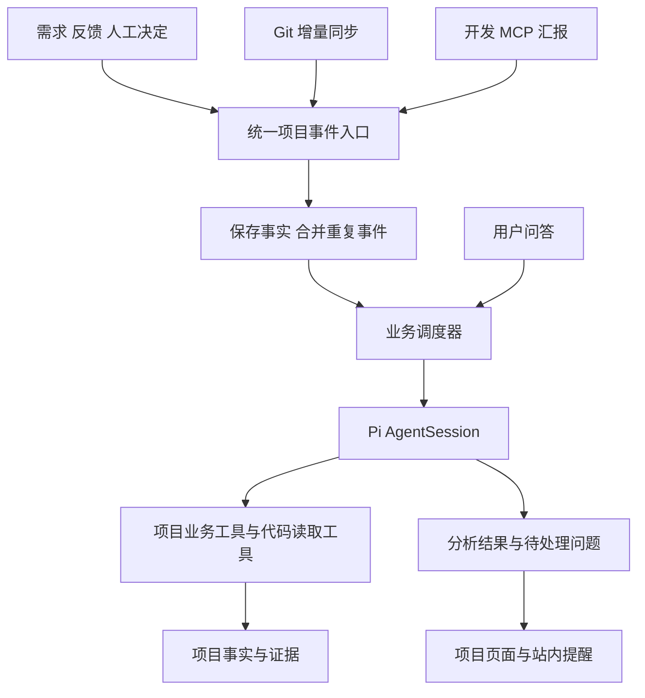

# AI 项目管理系统 MVP 产品方案

版本：0.1 评审稿  
日期：2026 年 10 月 10 日

面向使用 AI 辅助开发、仍由人负责方向和质量的团队，提供一个能持续理解项目情况的管理平台。PM 在平台提出需求、反馈问题和验收；开发者使用熟悉的开发 Agent，通过 MCP 获取任务和提交成果；平台 Agent 结合需求、Git 变化、开发汇报和验证记录，解释进度、回答项目问题并调查 Bug。

**MVP 的目标是打通需求协作、项目问答和 Bug 处理三个闭环。平台 Agent 的运行时使用 Pi SDK，模型调用、工具执行循环和会话能力复用 SDK。**

## 1 产品定位与设计原则

系统管理的基本单位是一次可以说明预期结果、可以验收的业务改进。事项分为需求和 Bug，两者共用协作流程；开发中的临时实现步骤保留在工作记录中，确有独立负责人或交付边界时再拆成关联事项。

系统主要解决四个问题：

- 项目进度依赖开发者反复解释，任务状态与真实成果容易脱节。
- 业务规则、代码、历史决定和测试记录分散，接手任务需要重新收集背景。
- 业务和测试提出的问题，需要工程师反复查代码、翻记录才能回答。
- Bug 反馈质量参差不齐，开发者在开始修复前需要重复整理现象和调查范围。

设计遵循以下原则：

1. 人负责需求取舍、关键业务决定和最终验收，能够在开发过程中随时介入。
2. Agent 的结论附带依据，区分已确认事实、分析判断和未知信息。
3. 工作成果自然产生项目记录，减少重复填写进度、日报和交接文档。
4. 一个项目共享一份事项、证据和决策记录，所有入口执行同一套业务规则。
5. 优先级使用“现在做、接下来做、暂存”，截止日期只在存在真实承诺时填写。
6. 已实现、已验证、已验收和已上线分别表达，自动分析不替代业务确认。

## 2 参与角色与职责

| 角色 | 主要职责 | 对外产出 |
| --- | --- | --- |
| PM 或业务负责人 | 提出目标，确认范围、优先级和验收条件，处理业务取舍 | 可执行需求、业务决定、验收结论 |
| 开发负责人 | 看管开发 Agent，确定实现方案，处理跨模块判断和交接 | 实现成果、技术决定、可信工作记录 |
| 测试或验收人 | 提交反馈，验证业务场景，决定是否通过验收 | 复现信息、验证证据、通过或退回结论 |
| 平台 Agent | 需求整理、代码和变更分析、进度解释、项目问答、Bug 初诊 | 分析结果、上下文摘要、待处理问题、Bug 单 |
| 开发 Agent | 在开发环境完成实现和验证，经 MCP 领取与汇报 | 提交或 PR、验证结果、阻塞及交接记录 |
| 平台业务服务 | 保存事实，执行权限、认领、状态流转和事件调度 | 可追溯且一致的项目记录 |

同一个人可以承担多个角色。开发 Agent 通过所属开发者的项目身份工作，不以模型名称作为责任人。平台 Agent 是项目助手，不自动成为需求决策者或验收人。

## 3 MVP 功能范围

| 功能 | 首版能力 | 完成标准 |
| --- | --- | --- |
| 项目接入 | 项目介绍、成员和角色、一个 Git 仓库、默认分支、读取凭据 | 能读取目标仓库，显示连接结果及最近同步时间 |
| Git 同步 | 首次目录与文档扫描，定期增量同步，手动刷新，读取提交及差异 | 能对比已观察版本与新版本，定位到确定提交和文件 |
| 需求管理 | 自然语言创建，Agent 整理目标、范围、验收条件和待澄清问题 | PM 能确认并放入待认领队列 |
| 开发 MCP | 查询、上下文获取、认领、进度汇报、阻塞、交接和提交结果 | 外部开发 Agent 能完成一次完整协作 |
| 进度解释 | 关联事项、开发汇报和 Git 变更，展示已完成、待完成与信息缺口 | 每条重要结论可以打开对应依据 |
| 项目问答 | 检索需求、决定、代码、工作记录和验证结果 | 回答说明适用版本、依据和未知项 |
| Bug 处理 | 反馈录入、重复问题检索、代码初诊、建单或关联、等待领取 | 开发者能拿到现象、预期、证据和下一步建议 |
| 验收与交付记录 | 提交验收包、人工通过或退回、记录环境和部署证据 | 能区分交付阶段并保留验收历史 |
| 项目知识 | 项目概况、模块目录、已确认决定，附来源和更新时间 | 新会话和接手者能复用已有背景 |
| Agent 使用与运行记录 | 配置模型提供方、模型和凭据，显示运行状态、工具摘要、错误、停止及重试 | 管理员能配置，用户能辨别运行中、失败和已完成 |

首版支持多个项目，每个项目先绑定一个仓库，仓库可以包含多个模块。Git 同步先采用通用的定期 fetch 和手动刷新，默认建议间隔 5 分钟，可配置；不要求一开始实现多个托管平台的专有接口。

持续观察默认分支及任务明确关联的开发分支，记录每个分支已读取到的提交。初次接入建立当前基线，后续处理新增差异；发现分支被重写或删除时重新核对，不把旧提交的分析直接套到新版本。

PR、CI 和部署信息在首版可以由开发 MCP 或人工附上链接、版本和结果。没有连接相应系统时，页面标注“开发汇报”或“人工记录”，不把链接存在等同于已独立核验。GitHub 或 GitLab 的专有事件、CI 结果自动读取和自动部署检测属于后续增强。

以下能力不属于 MVP：复杂甘特图和工时系统、无人看管的自动开发、平台直接修改或合并业务代码、自动发布、自动查询生产数据库、通用远程执行环境、多 Agent 分工平台、全量架构知识图谱、多仓库联合分析和通用审批流设计器。

## 4 核心对象与状态

### 4.1 核心对象

| 对象 | 保存什么 | 用途 |
| --- | --- | --- |
| 项目 | 介绍、成员、仓库、默认分支、模型配置、同步状态 | 界定上下文和访问范围 |
| 事项 | 需求或 Bug、目标、范围、验收条件、优先级、负责人、阶段、需求修订号 | 管理一次可验收的工作 |
| 工作记录 | 领取、发现、进展、阻塞、交接、提交结果 | 还原执行过程，支持换人和换会话 |
| 证据 | 提交、差异、文件位置、测试结果、日志、截图、验收和部署记录 | 支撑结论，注明来源、时间、版本和环境 |
| 分析与决定 | Agent 判断、待确认问题、人的决定及其适用范围 | 区分分析建议和已经生效的规则 |
| 验收包 | 一组事项、代码版本、场景清单、验证结果和未解决问题 | 支持跨事项共同验证，保留逐项覆盖关系 |
| Agent 运行 | 触发原因、项目、相关事项、Pi 会话、工具摘要、结果、错误和用量 | 查看分析过程并处理失败 |

证据、工作记录和分析由系统尽量自动关联，用户不需要分别维护多张表。事项与提交允许多对多关联：一个事项有多个提交，一个提交也可能同时服务多个事项。

### 4.2 事项主流程

需求评审 → 待认领 → 处理中 → 待上线 → 待验收 → 已验收。

“已取消”作为终止状态，保留原因和历史。“阻塞”作为附加标记，记录阻塞原因和待处理人，不覆盖事项原来的阶段。

| 状态变化 | 谁发起 | 需要什么 |
| --- | --- | --- |
| 待澄清到待认领 | PM 确认需求；符合条件的 Bug 可由平台 Agent 建立 | 目标或现象明确，验收条件或预期行为可描述 |
| 待认领到处理中 | 开发者或开发 Agent 领取 | 唯一有效认领，返回认领凭据及当前上下文 |
| 处理中到待上线 | 当前开发负责人或其开发 Agent | 提交结果、关联版本、验证情况和仍未验证项 |
| 待上线到待验收 | 项目成员或当前开发负责人 | 实际发布完成后登记当前版本、上线环境和结果证据 |
| 待验收到已验收 | 指定验收人 | 逐项验收结论，对应确定版本和环境 |
| 待验收到处理中 | 验收人退回 | 不通过原因和具体场景，保留上一轮记录 |
| 处理中交接 | 当前负责人释放，或项目负责人重分配 | 已有成果、下一步和未完成工作 |

平台 Agent 可以自动整理进度、创建 Bug、提出缺口和阻塞建议，但不能凭自己的分析直接把事项标为已验收。代码合并本身不会跳过待验收环节。

MVP 不因认领长时间无更新而自动让另一个 Agent 接管。系统显示“需确认”，由负责人继续、释放或交接，避免仍在本地工作的 Agent 被重复分配。

### 4.3 验证与部署分开记录

主流程旁显示“验证情况”和“部署情况”。验证情况可以是未提供、部分通过、失败或通过，并显示验证者与证据来源。部署情况按环境记录，缺乏证据时显示未知，不能推断为未发布或已发布。

验收包绑定事项修订号和代码版本。验收过程中范围或相关代码变化时，原结果保留为历史，新版本的相关条件显示需复核。跨事项合并验收时，每个事项仍单独记录通过、退回或尚未覆盖，允许部分通过。

## 5 核心流程

### 5.1 项目接入和初始理解

1. 项目负责人填写名称、介绍、Git 地址、默认分支和读取凭据，选择模型配置。
2. 平台验证仓库可访问性，建立项目独立的只读代码快照，记录分支及提交版本。
3. 平台 Agent 优先阅读 README、目录结构和相关文档，生成项目概况与模块目录草稿；具体代码按需深入读取。
4. 负责人可以修正业务说明。人工确认的规则与代码推断分别标注来源。
5. 项目进入持续同步状态，页面显示最近成功同步时间、当前观察版本和失败提示。

初始理解允许逐步完善。仓库较大时，先提供可用的目录与搜索能力，不以全库分析结束作为创建需求的前置条件。

### 5.2 从需求到验收

1. PM 输入自然语言需求，可以附截图、日志或参考链接。
2. 平台 Agent 整理目标、范围、验收条件和关键疑问，提示可能涉及的模块及重复需求。
3. PM 修改或确认整理结果，设置优先级、开发负责人范围和验收人，进入待认领。
4. 开发 Agent 通过 MCP 领取，获得当前需求修订、模块背景、历史决定、依赖和已有成果。
5. 开发者看管实现过程；Agent 在有阶段性成果、阻塞或方案变化时提交工作记录，无需逐轮汇报所有对话。
6. 平台把工作记录与已同步 Git 变更关联，更新进度解释；未推送的本地工作只能作为开发方汇报展示。
7. 开发 Agent 提交实现说明、提交或 PR、验证结果、已知限制和建议验收步骤。
8. 平台 Agent 对照验收条件整理验收包，指出未覆盖项；验收人体验结果并通过或退回。
9. 获得部署记录后，平台补充对应环境的交付事实。没有部署证据时维持未知。

流程中的需求变更保留修订记录。影响目标、范围或验收条件的变动，由 PM 确认；平台提示当前认领者更新上下文，提交结果时检查其依据的修订号，避免沿用过期要求。

### 5.3 从事件到进度解释

1. Git 同步、MCP 工作记录、人工决定和验收结果统一形成项目事件。
2. 平台合并同一事项的短时间重复事件，调用平台 Agent 分析新增内容。
3. Agent 优先使用显式事项编号、认领分支、提交和 PR 关联，再提出语义关联候选；模糊匹配标记为待确认。
4. 对照验收条件，更新“已经发生什么、尚缺什么、当前阻塞、下一步由谁处理”。
5. 发现汇报与代码或验证结果不一致时，形成待处理问题，不自动覆盖原始记录。
6. 只有新增阻塞、待决定问题、可验收成果和失败需要站内提醒；没有变化时不反复通知。

同步失败不抹去旧记录，也不据此判断开发停滞。进度摘要同时展示资料截止时间，提醒用户哪些事实尚未刷新。

### 5.4 项目问答

1. 用户在项目内提问，例如“部分退款现在做到哪里了”或“为什么结算后不能退款”。
2. 平台读取相关事项、已确认决定、最新可用代码及工作记录；需要更新时请求同步。
3. 平台 Agent 回答结论，附依据链接、代码版本、适用范围及未知项。
4. 涉及具体线上订单但缺少运行数据时，说明需要补充的订单状态或日志，仍然提供当前能够确认的规则。
5. 问题涉及新的业务取舍时，形成一个待决定问题交给负责人。用户可将明确的改进诉求转为需求。

问答默认不改动事项状态、不修改业务规则。一次回答中的猜测不会自动进入已确认知识。

### 5.5 从 Bug 反馈到修复

1. 用户提交现象、预期行为、发生环境和时间，可附复现步骤、截图或日志；信息不完整也可以提交。
2. 平台先保存反馈，再检查是否与已有 Bug 重复。确定关联时保留原反馈来源；不确定时只提示候选重复问题。
3. 平台 Agent 阅读相关规则、代码和近期差异，形成“已知事实、可能原因、定位范围、缺失信息、下一步”。
4. 问题可行动时自动创建待认领 Bug；需要补充信息时创建待澄清 Bug，并向反馈人提出具体问题。建单不以确定根因为前提。
5. Bug 进入开发队列，等待开发者或开发 Agent 领取。平台提供建议负责人，不强行打断开发者当前工作。
6. 开发 Agent 在开发环境复现，确认或纠正初诊，修复后提交根因说明、变更和回归结果。
7. 平台整理验收包，由测试或反馈人确认原始场景，再记录上线后的验证结果。

MVP 的平台初诊使用代码和已提供的资料，不承诺每个反馈都能自动确定根因，也不默认拥有生产日志或执行环境。未复现或未经运行证据确认的根因持续标为待验证判断。

## 6 平台 Agent 的职责与行为

### 6.1 五类核心能力

| 能力 | 主要输入 | 必须产生的结果 |
| --- | --- | --- |
| 需求整理 | 原始诉求、项目规则、相关代码和历史事项 | 目标、范围、验收条件、待澄清问题 |
| 进度分析 | 事项修订、工作记录、Git 差异和验证证据 | 已完成内容、剩余内容、阻塞、下一步、资料截止时间 |
| 项目问答 | 用户问题及相关事实 | 直接结论、依据、适用版本、未知项 |
| Bug 初诊 | 反馈、规则、相关代码、近期变更、已提供日志 | 定位范围、候选原因、证据、缺失信息和 Bug 单 |
| 上下文维护 | 已确认决定、实际变更和验收结果 | 可复用的项目概况、模块说明和决定记录 |

平台 Agent 的常规工具包括查询事项、检索决定、按版本读取代码、查看差异、读取证据、保存分析、创建 Bug 和提出待处理问题。业务写入通过平台服务执行，受当前项目权限和状态规则约束。

### 6.2 自主处理范围

平台可以自主更新带来源的分析摘要、创建未解决问题、建立 Bug 单、关联明确证据和生成验收建议。自动生成的内容有 Agent 标记，保留原始来源，允许人纠正。

需求范围和优先级的正式变更、关键业务规则的生效、验收通过及事项取消由相应负责人决定。平台不默认执行代码修改、合并或发布。简单、已明确授权的日常操作直接执行，不为每次分析增加人工审批。

Agent 的回答和摘要采用统一结构：结论、已确认事实、分析判断、信息缺口、下一步。页面可以简洁呈现，用户按需展开依据，无需阅读全部执行日志。

代码证据定位到仓库、提交、文件及必要行号；测试证据记录执行者、环境、范围和对应版本；人的决定记录确认人、时间及适用事项。开发方汇报属于有来源的证据，平台独立核验后可追加核验记录。

### 6.3 项目知识与会话的关系

项目事实保存在业务数据中，Pi 会话保存一次问答或分析的对话过程。项目概况和模块说明是可重新生成的摘要，不能覆盖原始事实。

首版按问答会话或分析工作建立 Pi 会话，用明确的项目和事项标识绑定上下文。后台分析与用户对话分别记录，避免所有工作挤在同一个不断增长的会话里。更换会话时重新装载相关项目事实和摘要，不依赖模型“记住”整个项目。

## 7 开发 MCP 的职责

开发 MCP 是外部开发 Agent 访问项目业务的标准入口，负责结构化读写、身份识别、任务认领和操作回执。它与 Web 界面、平台 Agent 的内置工具共用同一套业务服务。平台 Agent 可以直接调用内部工具，无需经网络调用自己对外的 MCP。

以下是首版工具的产品级定义，名称用于表达职责，参数细节在技术设计中确定。

| 工具 | 用途 | 关键回执或限制 |
| --- | --- | --- |
| `project_get_context` | 获取项目概况、模块和已确认规则 | 返回来源、更新时间及观察到的代码版本 |
| `task_list` | 按项目、类型、优先级、负责人和状态查找事项 | 区分可认领、已归属和阻塞事项 |
| `task_get_context` | 获取完整任务上下文 | 返回需求修订、验收条件、决定、证据及已有成果 |
| `task_claim` | 认领待处理事项，或由当前负责人重新绑定会话 | 返回认领凭据和上下文；并发冲突明确失败 |
| `task_report_work` | 汇报进展、发现、问题、阻塞或阻塞解除 | 追加工作记录，可关联提交、日志和待决定问题 |
| `task_get_updates` | 获取上次读取后的需求变更、决定和评论 | 返回增量记录及下一次读取位置 |
| `task_release` | 释放或交接任务 | 保存交接说明，结束当前认领并更新队列 |
| `task_submit_result` | 提交本轮实现和验证材料，进入待上线 | 校验认领及需求修订，进入待上线，保留缺口 |
| `project_ask` | 向平台 Agent 查询规则和项目背景 | 返回有依据的回答；耗时分析返回可查询的运行标识 |
| `analysis_get` | 查询平台分析的运行状态和结果 | 返回排队、运行中、成功、失败或停止及已有结果 |
| `delivery_record` | 附加测试或部署记录 | 记录来源、环境和版本，不自动授予验收结论 |

状态修改通过有业务含义的操作完成：认领进入处理中，提交结果进入待上线，确认实际上线后进入待验收，释放结束当前认领。开发 Agent 不获得任意改写所有状态的通用接口。

写操作需要能够识别调用者、项目、事项和一次请求，返回生效结果。认领和提交采用并发校验，同一次请求重试返回原回执，避免重复建记录或重复交付。用户修改了需求后，旧修订的结果不能直接当作新要求的完成证明。

交接或重分配后，旧认领凭据失效。旧 Agent 再次提交时收到明确提示，可以保留为待接手人核对的成果，不得改变新负责人的执行状态。

MCP 不负责运行开发 Agent 或提供其 IDE。首版由开发者启动开发 Agent，主动查询和认领任务；运行中的开发 Agent 按协作约定读取新增决定。任务进入队列不会自动唤醒一个未运行的本地客户端。

项目提供一份简短的开发协作说明：开始前领取并读取上下文，遇到阻塞及时汇报，提交前获取最新决定，结束时提交成果或交接。外部开发 Agent 可以使用任意支持该 MCP 的工具，不要求采用 Pi。

## 8 Pi SDK 运行时方案

### 8.1 已确定的技术边界

**平台 Agent 采用 Pi 的 AgentSession SDK。平台只实现业务集成，不自研模型与工具的执行循环。**

Pi 官方 SDK 支持嵌入 Node.js 或 Bun 进程，提供会话、模型、工具和事件能力；`createAgentSession` 创建会话，`SessionManager` 管理会话记录，可配置项目工具与资源。[Pi SDK 官方文档](https://raw.githubusercontent.com/badlogic/pi-mono/main/packages/coding-agent/docs/sdk.md)

当前上游主分支包名为 `@earendil-works/pi-coding-agent`。实施时锁定经验证的官方发布版及其配套依赖，不直接跟随主分支；本方案不把主分支版本视为已经发布或完成兼容性验证的依赖。[上游包定义](https://raw.githubusercontent.com/badlogic/pi-mono/main/packages/coding-agent/package.json)

| 由 Pi SDK 承担 | 由项目平台承担 |
| --- | --- |
| 模型交互与工具调用循环 | 项目身份、事项、证据、状态与权限 |
| 会话历史、上下文压缩和会话恢复能力 | 项目事实检索、相关上下文组装与会话绑定 |
| 流式事件及运行生命周期接口 | 页面状态、分析记录、用量和错误展示 |
| 工具与资源扩展机制 | Git 只读工具、项目业务工具和开发 MCP 服务 |
| 排队输入、引导和停止接口 | 事件去重、运行调度、业务重试与写入一致性 |

平台侧优先采用 TypeScript 的 SDK 集成层，直接使用完整会话能力。即使其他业务服务采用不同技术栈，也只通过薄适配层调用 Pi，保持一套运行时。

### 8.2 事件调度和执行

Git 同步、开发汇报和用户请求统一进入平台业务调度。调度器决定何时启动分析，Pi 负责一次分析内部的模型和工具执行；不再增加第二套 Agent 工作流引擎。

同一事项的后台分析串行处理或合并新增事件，避免同时写出互相覆盖的摘要；项目问答可以独立运行，回答标明读取时的事实版本。连续提交和重复汇报合并处理，不要求每个事件都调用模型。

每次运行设定可配置的时长、工具调用或用量预算。同步、模型或工具失败后保存已有成果，显示错误并允许重试。重试先检查业务写入回执，避免重复创建 Bug 或重复变更状态。

### 8.3 交互和停止

界面显示正在检索、分析、生成结果等简短状态，以及可展开的工具执行摘要。支持用户补充信息和停止当前运行。

Pi 的 `steer` 用于后续执行中的引导，`followUp` 排队到当前运行结束后处理，`abort` 用于停止；引导输入不等于即时取消。平台的停止按钮调用 SDK 停止能力，并向可取消工具传递取消信号。已经成功的业务写入保留并显示，停止不宣称自动撤销这些操作。[Pi SDK 输入与生命周期说明](https://raw.githubusercontent.com/badlogic/pi-mono/main/packages/coding-agent/docs/sdk.md)

项目工具显式开放代码读取和受约束的业务操作。首版不向平台 Agent 提供任意命令执行、代码写入和部署工具；仓库文档、日志和外部内容作为待分析资料，不得改变平台的身份与业务权限。Pi 的会话能力不替代项目权限校验。

## 9 页面结构

平台采用一个项目工作区，主要包含以下页面。

| 页面 | 主要内容 | 最重要的操作 |
| --- | --- | --- |
| 项目概览 | 当前推进事项、近期变更、待处理问题、资料更新时间 | 进入事项、提问、刷新项目事实 |
| 事项队列 | 需求与 Bug，优先级、负责人、阶段和阻塞 | 创建、筛选、认领或调整优先级 |
| 事项详情 | 原始诉求、验收条件、进度解释、讨论、决定、证据和工作记录 | 澄清、处理决定、提交或执行验收 |
| 项目问答 | 带依据的回答、代码和事项引用、已有会话 | 追问、补充资料、转为需求或反馈 |
| 验收与交付 | 待验收包、逐项结果、版本和环境记录 | 通过、退回、追加部署或业务验证证据 |
| 项目设置 | 仓库、成员、模型、凭据、同步和 MCP 接入 | 连接检查、生成接入信息、查看失败运行 |

“需要我处理”作为概览和事项队列的快捷筛选，集中显示待澄清、待决定、待验收与交接请求，不再新建一套独立任务系统。

事项详情优先展示目标、现状、阻塞和下一步。原始 Git 差异、调用日志与完整对话按需展开。首版只做站内提醒，后续再接企业微信、邮件等渠道。

## 10 MVP 验收标准

以下是首版应通过的产品验收场景，不代表当前已经实现。

| 场景 | 应得到的结果 |
| --- | --- |
| 接入真实项目 | 保存仓库配置后能读取代码和分支，形成初步概况；失败时显示原因和最后成功状态 |
| 创建并澄清需求 | PM 能修正 Agent 的整理结果，确认后进入可认领队列 |
| 外部 Agent 协作 | 一个 MCP 客户端可完成查询、认领、读上下文、汇报、提交结果 |
| 并发认领与重试 | 两个客户端同时领取只有一个生效；同一写请求重试不产生重复记录 |
| 人在开发中介入 | PM 新增决定后，开发 Agent 能获取增量；旧需求修订不能悄悄覆盖新要求 |
| Git 与汇报不一致 | 平台分别展示开发汇报和已观察代码，说明缺口；未推送工作不当作仓库事实 |
| 回答真实项目问题 | 对代表性的进度、规则和代码问题给出可打开的依据；缺少运行数据时保留未知 |
| Bug 自动整理与建单 | 完整反馈进入待认领，不完整反馈进入待澄清；疑似重复问题不丢失原始反馈 |
| 初诊允许纠正 | 开发者确认的新根因更新分析，保留早期判断及其证据，避免将猜测写为事实 |
| 跨事项验收 | 一个验收包覆盖多个事项，每项独立记录通过或退回，相关版本变化后提示复核 |
| 验收和上线区分 | 已验收但无部署证据时，生产状态仍为未知；提供证据后能显示对应环境和版本 |
| 运行停止与恢复 | 用户可以停止 Pi 运行，查看已完成步骤；重试不重复执行已落库的业务动作 |
| 项目隔离 | 不同项目的代码、凭据、会话和 MCP 访问互不串用，开发身份无法直接完成业务验收 |

试点时选取一个真实项目，覆盖新增需求、已有功能改动和 Bug 修复三类事项。重点观察四项结果：

- PM 能否不追问工程师就获得可用的进度解释，以及需要人工纠正的主要原因。
- 项目问答中，能够凭已有资料解决的问题比例及答案依据是否充分。
- Bug 从反馈到可认领所需的补充轮次和人工整理时间。
- 开发者维护平台记录所花的额外时间，及自动生成内容是否反而增加负担。

先记录试点基线，再设定数值目标；不以提交数量、生成代码行数或 Agent 调用次数作为项目成效。

## 11 实施顺序和后续扩展

第一阶段完成项目、事项、认领和证据模型，接入 Git 读取，并通过开发 MCP 跑通人工看管的需求交付。此时任务协作即使暂时没有智能分析也能使用。

第二阶段接入 Pi SDK、项目工具、带依据的问答和进度分析，把人工整理记录转为平台自动处理。

第三阶段打通 Bug 初诊、自动建单、跨事项验收、运行失败恢复和站内待办，完成全部 MVP 验收场景。三个阶段按可演示的业务闭环验收，不在产品方案中预设开发天数。

后续根据试点结果增加 Git 托管平台 Webhook、CI 和部署事件、授权运行日志查询、多仓库关联和企业消息通知。自动开发执行器是否加入，由实际协作质量决定，不作为当前产品成立的前提。

## 12 本版采用的默认范围

为使方案可以直接进入评审，本版采用以下默认范围：内部团队使用；支持多个项目但每项目一个仓库；开发者主动启动并看管开发 Agent；平台 Agent 使用 Pi SDK；Git 定期同步并支持手动刷新；首版生产信息来自明确提交的证据；验收由指定人员完成。

技术设计阶段再确定部署方式、数据库与文件存储选型、首批模型提供方和 Pi 发布版本。若试点项目必须跨仓库或必须接入某一套 CI，可据实际项目调整接入范围；上述选择不改变事项、证据、验收和 Agent 职责的基本模型。
